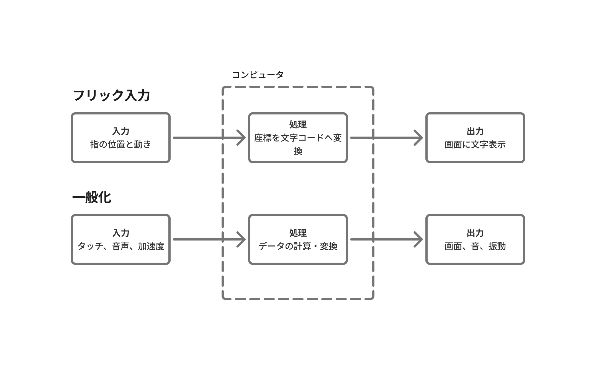

この章では、やわろかくの活動にいたるにあたって、着想の手助けになった資料を述べたい。やわろかくの活動概要（[About](./../../)）を要約すると下記である。

スマホのインターフェース(タッチパネル)が誕生したことにより、**人は歩きながら文字を書ける**ようになった。それは文字を書くことをスマホが肩代わりしてくれているからだ。スマホの機能を考えれば、もっと多様な「文房具」が作ることができるし、その文房具により「多様なコンテンツを」生み出すことができるはずである。やわろかくは「あってもよいはずの文房具と書かれるコンテンツ」を運営をしていくことが目的である。
　なぜ「歩きながら文字が書ける」ことに注目するのか。それは「書くことが手元から離れコンピュータが代筆することによって、書き手がある状況の経験を事後的な振り返りを経ずにその状況の中で感じたことを文章に組み込むことができる」ようになったからだ。やわろかくは、このように文字が書かれるプロセスが変わることで、文章の構成要素が変わり、新しいタイプの知のシステムを作り出し、運用していきたいと考えている。

では、なにが「新しいタイプの知のシステム」になりえるかを話してみたい。

人がスマホで文字を書く時に、スマホの画面の文字は入力・処理・出力のプロセスを経て画面に表示されている。例えば、スマホで文字をフリック入力で書くことを思い浮かべてみよう。まずタッチパネルの画面上のフリックキーボードの上を指が動く(フリック入力)とき、スマホにその指の位置と動きを入力され、内部で指の位置と対応する文字を一致させた後、タッチパネル上に文字が表示される。よく考えると、この入力・処理・出力は文字表示に限定されたものではない。コンピュータの入力・処理・出力の手続きにおいては、スマホのカメラアプリやGoogle Map、その他スマホ上で動くアプリのプロセスは文字を書くのと同じプロセスを通る。であれば、コンピュータを"文字"を書く時の定義を「入力・処理・出力の手続き」としてその定義を見直すことができるのではないか。

こういった”文字”の再定義についての着想は、「一般文字学=(グラマトロジー)」という概念を提唱したフランスの哲学者デリダを参照して考えるいたった。デリダは西洋で特権的にあつかわれてきた表音文字だけでなく、象形文字などの非表音的な文字体系にも注目した。デリダは文字を「声の単なる記録」ではなく、それ自体が自立した「痕跡」のシステムであると捉え直している。グラマトロジー（一般文字学）は、言語の枠組みだけで考えるのではなく、コンピュータのプログラムや遺伝子情報など、あらゆる情報の記述や記録のシステムまでも包括しうる概念として提唱している。その後デリダの「グラマトロジー」の概念は十分に論証されたとはいえないが、後にデリダの考え方を引き継ぎつつ、人類が生み出してきた技術に着目したスティグレールが、グラマトロジーの概念を継承・発展させている。ここで軽く述べると、スティグレールは痕跡それ自体だけでなく、痕跡の残し方にまで踏み込んでいる。それは粘土版に刻むこと、活版印刷で刷ること、コンピュータで処理することは、人間や社会に与える影響が異なるからだ。それを文字化（grammatisation）という概念で説明している。詳細は別の機会に譲りたい。

デリダのグラマトロジーから、「文字」を捉え直すなら、スマホのセンサーを介した様々な入力は、文字を作るための痕跡を一般文字学として捉えることができそうだ。
　ここでスマホのセンサーにより取得できる情報を、人間でいうところの五感からの情報取得に置き換えてみよう。人が「机に向かって」文字を書くときと、スマホを補助具として「歩きながら」文字を書くときでは、視覚と他４感から取得される情報の量と質が異なると言える。つまり、文字が書かれる環境において、人間が目・耳・鼻・肌などから取得する「感覚比率」が異なる情報によって文章が生まれるのである。
　「感覚比率」とは、その昔活版印刷の技術が生まれ、新聞紙や書籍の流通が当たり前になり、かつてなく文字に囲まれた社会で、人が過度に視覚に頼ったコミュニケーションが前提になったことを批判したカナダのメディア研究者にマクルーハンの言葉である。私たちはスマホを補助具として、これまでの文章とはことなる「感覚比率の文字」を用いた文章を書くことが可能になっているのだ。

グラマトロジーが想定する文字とその文字を書くコンピュータを補助具と考えると、書く内容だけでなく、書き手の存在も変わっていく。かつてのヨーロッパ社会では、文章を書く行為は一部の階層の男性に偏って担われていたが、タイプライターの登場によって女性の書き手が飛躍的に増えた。これはドイツのメディア学者のフリードリヒ・キットラーが「グラモフォン・フィルム・タイプライター」で「男の手から女の機械へ」という章で指摘したことだ。キットラーは知と権力の結びつきを歴史的に分析したフーコーを技術的な背景を加えて論を展開している。つまり書く行為とその道具の環境を変容させることは社会のあり方を変えてしまうことを指摘しているのだ。道具によって書かれる文字と、その文字によって知が生まれ、流通することで、社会のあり方を変える力が生まれる。だから、文字だけでなく、その道具にも注目することが必要なのだ。

道具と知の関係について述べたが、もちろん知は道具が変わることのみによって生まれるのではない。道具によって書き手が変われば、道具の使い方もまた異なってくる。新しい知を生み出すことにとって重要なのは、知を生み出す書き手が多様になることも必要である。

多様な書き手は多様な主観性をもつ。この主観性が知につながるという考え方は、フッサールの間主観性から着想を得ている。フッサールは客観的な知としての一番歴史の古い幾何学について述べている幾何学の起源序説で次のことを述べている。客観的な知もはじめは個人の内面にある「主観」的な経験だったと指摘する。それが他者とも共有可能な「客観」的な理念になり（知）になると述べた。それが知は主観が人の間で共有されることで生まれると考えられている。

ここまでをまとめると、文字を道具であるコンピュータから考えるため、デリダのグラマトロジーの概念を採用した。結果、コンピュータで入力される様々な情報により文章を書ける
ようになることで、人間でいう５感が文章に盛り込まれることをマクルーハンの感覚比率を例に述べた。また、書く道具は書き手も変えることをキットラーを引用し述べて、また多様な書き手による知の誕生についてはフッサールを引用して述べた。yawarokakuは、「文字」と「書く道具」と「書き手」による新しい知のシステムを運営することを目指している。
